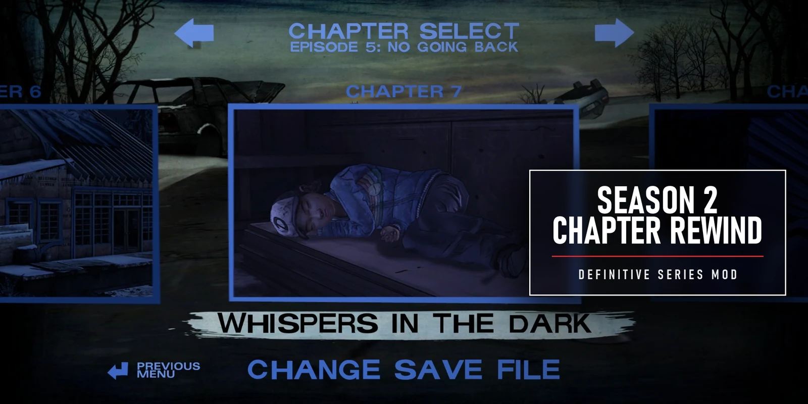
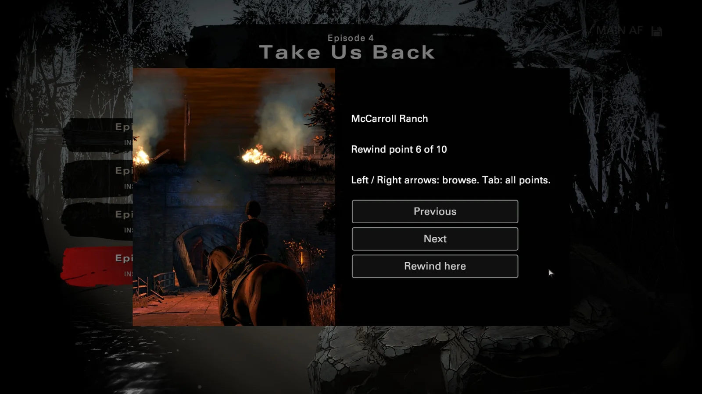

# Chapter Rewind for The Walking Dead: The Telltale Definitive Series

[](https://github.com/infernokun/TWD-Definitive-Rewind/releases/latest)
[](https://github.com/infernokun/TWD-Definitive-Rewind/releases)
[](LICENSE)



Rewind to an earlier point from the episode select, in the seasons that don't have it:

- **Season 2** shipped in the Definitive Series with its chapter rewind switched off. This mod switches it back on, exactly as the original Season Two had it.
- **Season 3 (A New Frontier)** and **Season 4 (The Final Season)** never had rewind, and never kept the saves it needs: every checkpoint overwrites the one autosave. This mod adds a rewind menu that works on saves you already have: it lists every scene you reached in the episode, rebuilt from the season's choice log, and going back to one keeps every choice you made before it. It uses the save, log and scene code those seasons already contain.

Season 1 and Michonne kept their own rewind and are not touched.



- Six files, added next to the game's own archives.
- No stock game file is modified, and removing it takes seconds.
- Works on the Steam PC version.

> **Status:** Seasons 2 and 4 are tested in game. Season 3 is new in 2.0.0 and **has not been fully checked in game yet** (see [TODO.md](TODO.md)). Back up your saves before trying it (see below), and please report what happens.

**[Download the latest release](https://github.com/infernokun/TWD-Definitive-Rewind/releases/latest)**

## Using it

All three seasons do it from the **episode select**: main menu, pick the season, then the episode.

| Season | Where | What you get |
|---|---|---|
| 2 | Pick an episode | The chapter panels are back. Pick a chapter you've reached, then **Rewind** (or branch into another save slot). |
| 3 | Select an episode, open **More Options** | A **Rewind** entry. It opens the rewind list (below); pick a point and confirm. |
| 4 | Pick an episode you've played (its button says Restart), or press **Restart Episode** | The rewind list: "From the beginning" (the stock restart), then the episode's rewind points. On a controller there's also a **Rewind** hint (X / left face button). |

The rewind list has, in order:

- **From the beginning**: the stock restart of that episode.
- **Every scene you reached in the episode**, in the order you played them, named the way Telltale named them in their own scene list ("Forest Camp", "Greenhouse", "Boarding School Interior (act 2)"). Rewinding to one starts the episode in that scene with everything you did before it kept.
- **Saved: …** entries: exact saves the mod keeps at the start of each scene while you play with it installed. These bring back the game exactly as it was. A save made at the start of a scene that is already listed as a scene point isn't listed again.

The points are numbered in that order. Each has a picture:

- **Season 4:** Rewind opens straight onto the picture of your latest point: a screenshot from the start of that scene (`src/pictures/s4`), its name, "Rewind point 6 of 10", and **Previous** / **Next** / **Rewind here**. Previous and Next step through the episode's points and wrap around. So do the **Left / Right arrow keys**, or **LB / RB** on a controller. **Tab** (Y on a controller) shows the list of all points, four buttons at a time (**More...** / **Back...** page through it), and picking one opens its picture. **Esc** (B) closes. From the beginning shows the episode's first scene, and Saved entries show the scene they were saved in.
- **Season 3:** the list, four buttons at a time, with a picture strip on the left that follows the highlighted row, using the location matte paintings. Points with no matching painting show the episode's art.

### What can be rewound in Seasons 3 and 4

- **The start of any episode you've played**, on any save (the stock restart).
- **Any scene you reached**, on any save, including progress from before the mod. Seasons 3 and 4 record every dialog node you play and every choice you make in a choice log, and read your story back from it. The mod cuts that log right after the last save before the scene and starts the episode in that scene, so everything before it is kept: earlier episodes, choices and dialog you've seen. What isn't in the log is reset to how the scene normally starts, for example where characters stand or temporary in-scene states. The "Saved" entries don't have that limit.
- With nothing in the log for that episode yet, the list says "No rewind points yet".

## Things to know

- **Rewinding deletes every save after the point you pick, including later episodes.** The original games worked the same way. To keep a finished playthrough, copy your save folder first: `Documents\Telltale Games\The Walking Dead Definitive`. Files starting `wd2_` / `_wd2_` are Season 2, `wd3_` Season 3, `wd4_` Season 4.
- Steam Cloud (and any folder sync you run on that folder) will sync the deletions too. Copy the folder somewhere outside it.
- In Seasons 3 and 4 each rewind point is a full save (a few hundred KB), one per scene, so a season played with the mod keeps a few dozen extra files in the save folder.
- Season 2 can branch into another save slot. Seasons 3 and 4 only rewind the current slot.
- The new Season 3/4 menu text ("Rewind", "From the beginning", …) is English only.
- If another mod ships its own `DebugLoader.lua` (Seasons 3/4), `GameOverrides.lua` (Season 4) or `Menu_chapters.lua` (Season 2), the one with the higher priority wins.
- Tested on the Steam build dated 2020.01.29 (Season 108-RC). Other storefronts use the same archives but haven't been tried.

## Install

### With the Telltale Mod Launcher (recommended)

Use [my fork of the Telltale Mod Launcher](https://github.com/infernokun/TelltaleModLauncher), version [0.7.0](https://github.com/infernokun/TelltaleModLauncher/releases/tag/v0.7.0) or newer. It runs on Windows and Linux and needs nothing else installed.

1. If you have the Season 2-only 1.x release installed, remove it in the launcher first.
2. Download the mod's zip from [Releases](https://github.com/infernokun/TWD-Definitive-Rewind/releases/latest). Don't extract it.
3. Open the launcher, pick The Walking Dead: The Telltale Definitive Series, and drop the zip onto the window (or use Add mod).
4. Play.

### With the install script

1. Download the zip from [Releases](https://github.com/infernokun/TWD-Definitive-Rewind/releases/latest) and extract it anywhere.
2. Right-click `install.ps1` and choose Run with PowerShell. It finds the game through Steam, removes the 1.x files if present, and copies the six files into the game's `Archives` folder.

If the script can't find the game, pass the path:

```powershell
.\install.ps1 -GameDir "D:\SteamLibrary\steamapps\common\The Walking Dead The Telltale Definitive Series"
```

### By hand

Copy these six files into `...\The Walking Dead The Telltale Definitive Series\Archives\`:

```
WDC_pc_Mod_TWDRewind_S2_data.ttarch2
_resdesc_50_Mod_TWDRewind_S2.lua
WDC_pc_Mod_TWDRewind_data.ttarch2
_resdesc_50_Mod_TWDRewind.lua
WDC_pc_Mod_TWDRewind_S4Game_data.ttarch2
_resdesc_50_Mod_TWDRewind_S4Game.lua
```

If you installed 1.x by hand, delete `WDC_pc_Mod_S2Rewind_data.ttarch2` and `_resdesc_50_Mod_S2Rewind.lua` from the same folder.

## Uninstall

Remove it in the launcher, run `uninstall.ps1`, or delete the six files from the Archives folder. Steam's "verify integrity" won't remove them on its own because they are additions, not replacements. Rewind points already saved stay in the save folder as ordinary saves.

## How it works

At startup the engine reads every `_resdesc_50_*.lua` file in the Archives folder. Each one registers a resource set with a priority and a list of archives. When two sets contain a file with the same name, the higher priority wins. Telltale used this for their own PC patches. The mod registers three sets.

### Season 2: `Mod_TWDRewind_S2` (mounted into `<MenuSeason2>`, priority 700)

The Season 2 episode menu lives in `Menu_chapters.lua` inside `WDC_pc_MenuSeason2_data.ttarch2`. Compared with the original Season Two script, the Definitive Series version differs in three places:

| | Original Season Two | Definitive Series | This mod |
|---|---|---|---|
| Chapter list | built for every autosave | gated behind a new `Menu_Chapters_RewindIsSupported()` that always returns `false` | returns `true` |
| Picking a chapter | "Rewind" popup, then choose a save slot to copy into | "Restart Episode" popup | original popup and flow restored |
| Button label | `navhelp_rewind` ("REWIND") | `navhelp_restart` | `navhelp_rewind` |

Everything the feature depends on (the save-slot rewind code, `SaveLoad_Revert`, the menu text, the chapter thumbnails) is still in the Definitive Series, untouched. The patch is three small edits to the compiled Lua bytecode, shipped as a newer copy of that one file.

### Seasons 3 and 4: `Mod_TWDRewind` (mounted into `<Project>`, priority 700)

This set adds two scripts (plus two generated tables and the rewind pictures) and **replaces no stock file**.

**Getting loaded.**

- Every season's `Menu_Main.lua` requires `DebugLoader.lua` if it exists. That file is in Telltale's developer builds, not the retail game. The mod ships one that loads **`TWDRewind.lua`** and provides the one object its callers use, `Callback_OnLoadDebugMenu`. It adds no tools or debug features.
- Inside episodes, the retail game never asks for an optional file: `ProjectInclude.lua` requires `WalkingDeadTools.lua` only `if IsToolBuild()`. Season 4 episodes load the mod through the third set, below. Season 3 episodes don't load it, so there the "Saved" points aren't made and a scene point starts without its act setup.
- Starting an episode, and every scene change inside one (`Game_EndScene`), starts a fresh Lua state. The menu's state answers the episode's first-script lookup, and anything that has to reach the episode's state (the scene jump) goes through the preferences.
- Because `require` runs a file only once, `TWDRewind.lua` wraps `require` and re-checks its hooks after every later load, so they go in as soon as `SaveLoad.lua`, `Menu_Episodes.lua` and `Game.lua` exist.

**Rewind points.** Every episode calls `Checkpoint("node")` many times (43 times in Final Season episode 1). Michonne's episodes call `Checkpoint("cs_ENTER", "101_chapter2")` at chapter starts, and that chapter ID is what makes `SaveLoad_Checkpoint` write a numbered save (`_wdm_saveSlot1_checkpointN.bundle`) instead of overwriting the autosave. Seasons 3 and 4 never pass one. The mod wraps `SaveLoad_Checkpoint` and passes the scene's dialog name as the chapter ID for the first checkpoint of each scene, so the stock code saves `_wd3_…_checkpointN` / `_wd4_…_checkpointN`. Every other checkpoint stays an autosave, as before. Nothing else in Seasons 3/4 reads the chapter ID.

**Menu.**

- Season 3: `Menu_Episodes_GenerateMoreOptions` gets a "Rewind" entry.
- Season 4: `Menu_Episodes_Restart` opens the rewind list first. The episode buttons of played episodes call it too, and the list's first entry runs the stock restart. `Menu_Episodes_UpdateLegend` adds the controller hint.
- The list is a copy of the stock More Options popup (`ui_popupMoreOptions.scene`) fed with the episode's numbered saves.
- Picking a "Saved" entry runs `SaveLoad_Revert` (deletes later saves and cuts the choice log back to that save), then the season's own `Menu_Episodes_Continue`, which loads the newest save: the one you picked.

**Scene points from the choice log.**

- The season's event log (`_wd3/4_saveslotN_id.estore` and its pages) records Begin Episode, Start Scene (the scene, as a symbol), Executing Dialog Node, Dialog Choice, Checkpoint and Save Serial (one numbered event per save) for the whole playthrough. The stock game reads choices and seen dialog back from it, which is how it restarts an episode without a save.
- Every episode's `Episode.lua` still contains Telltale's developer scene list (`DebugMenu_AddButton(act, "Forest Camp", "ForestCamp", "LogicSet( kAct, 2 );")`), used in tool builds to jump into a scene. `tools/gen_scene_table.py` turns those into `src/lua/TWDRewindScenes.lua`: label, scene script, the scene file it opens and its act.
- The list matches the log's Start Scene events of this playthrough of the episode to that table in play order (`QueryEventLog`).
- Rewinding to one:
  1. deletes this and later episodes' saves (`SaveLoad_RestartEpisode(ep, true)`);
  2. cuts the log after the last save before that scene (`EventLog_TruncateAtSave`, what the game does when it loads a save);
  3. rebuilds the slot's metadata from the log (`updateMetadataAfterDelete`);
  4. starts the episode (`Menu_StartEpisode`).
- The menu answers the episode's `SubProject_GetEpisodeFirstScript` lookup with that scene's script, so the episode boots straight into it. In Season 4 the episode's own state then finds the jump in the preferences, and the `Game_StartScene` hook applies only the entry's act number and "entered" flags, just before the scene's start logic. The developer entries' test choices are never applied.

**Pictures.**

- The pictures (`twdr_*.d3dtx`) are cut at build time from the game's own textures by `tools/make_pictures.py`, following `src/pictures.json`. Each is written with the header of a stock texture of the same layout; only the file name inside it changes.
- Season 4 uses the stock picture popup, `Menu_PopupWindow` (the one behind the Crowd Play intro). It shows the left part of a 1920x1080 DXT1 texture next to a message and up to three buttons. The mod passes the scene's picture as its texture, the scene name as its message, and Next / Rewind here / Back to list as its buttons. Previous and Back are added as controller legend entries (`legendOverride`, as Season 4's own popups do), and Esc is handled on the popup's menu.
- Season 3's own More Options window has a picture strip on the left (`ui_popupMoreOptions_imageHolder.d3dtx`, texture columns 156-355 of a 512x512 DXT5). The list sets it with `ShaderOverrideTexture` and follows the highlighted row with `Buttons_SetSelectedCallback` (on the scene object, as the stock tooltip display does). Borrowing that window for Season 4 didn't work: the window loads there, but its strip never draws.

### Season 4 episodes: `Mod_TWDRewind_S4Game` (mounted into `<ProjectSeason4>`, priority 700)

Every Season 4 episode requires `GameOverrides.lua` (`EpisodeInclude.lua`, right after `Game.lua`). This set ships a `GameOverrides.lua` that runs the stock one, shipped as `TWDRewind_S4_GameOverrides.lua` and extracted from your game at build time (it is not in this repo), and then loads `TWDRewind.lua`. Only Season 4 mounts this set, so the other seasons' `GameOverrides.lua` are untouched.

Every wrapper checks the current save slot (`wd3_…` / `wd4_…`) and does nothing in other seasons. Any error leaves the stock behaviour in place. The scripts are compiled with `luac` (Lua 5.2), the same format as the game's own scripts.

## Building from source

Requirements:

- Windows and Python 3 with Pillow and numpy (for the pictures).
- [ttarchext](https://aluigi.altervista.org/papers.htm#ttarchext) 0.3.2 or newer.
- `luac.exe` from the Telltale Modding Group's [Telltale Script Editor](https://github.com/Telltale-Modding-Group/Telltale-Script-Editor) (`resources/luac.exe`, Lua 5.2.4). The build checks that its output has the game's bytecode header.
- The game installed.

```powershell
.\build.ps1        # put ttarchext.exe and luac.exe in tools\, or pass -Ttarchext / -Luac <path>
```

The build then:

1. extracts the stock Season 2 `Menu_chapters.lua` from your game install (it is not in this repo) and patches it;
2. makes the rewind pictures: Season 3's are cut out of the game's own textures (not kept in this repo), Season 4's from the scene screenshots in `src\pictures\s4`; then compiles `src\lua` and the generated picture table;
3. packs both archives and encrypts both descriptors;
4. extracts everything again to check it round-trips;
5. writes `dist\` with checksums.

The Season 4 pictures were captured with a separate development tool, [tools/capture-tour](tools/capture-tour/README.md). It drives the game through every scene, screenshots each one and helps pick and crop the shots. Its README also covers what we had to learn about the engine to do that. It is not part of the mod: `build.ps1 -CaptureTour` packs it into a separately named capture build, and the normal build leaves it out. The only trace in the mod is a generic hook at the end of `TWDRewind.lua` that loads `TWDRewindAddon.lua` if an archive provides one, and the release ships none.

Repository layout:

```
src/lua/TWDRewind.lua                        Season 3/4 rewind points and menu (source)
src/lua/TWDRewindScenes.lua                  generated from the games' developer scene lists (tools/gen_scene_table.py)
src/lua/DebugLoader.lua                      loads TWDRewind.lua from the menus
src/lua_s4game/GameOverrides.lua             loads TWDRewind.lua in Season 4 episodes, after the stock GameOverrides.lua
src/resdesc/_resdesc_50_Mod_TWDRewind_S4Game.lua resource descriptor for the Season 4 episode set
src/resdesc/_resdesc_50_Mod_TWDRewind.lua    resource descriptor for the Season 3/4 set (encrypted at build time)
src/resdesc/_resdesc_50_Mod_TWDRewind_S2.lua resource descriptor for the Season 2 set
src/pictures.json                            the picture of each rewind point: a game texture (Season 3) or a screenshot and its crop (Season 4)
src/pictures/s4/                             Season 4 scene screenshots, one per rewind point (taken with tools/capture-tour)
tools/make_pictures.py                       builds the pictures and the picture table
tools/capture-tour/                          development tool, not in the mod: the screenshot tour that took the Season 4 pictures (see its README)
src/modinfo_twd_rewind.json                  Telltale Mod Launcher manifest
tools/luapatch52.py                          Lua 5.2 bytecode parser and writer, exact round-trip, 4-byte floats as Telltale uses
tools/patch_menu_chapters.py                 the three Season 2 edits
tools/luadis.py                              disassembler used to review bytecode
tools/common.ps1                             file names and Steam library lookup shared by the scripts
```

## Credits

- ttarchext by Luigi Auriemma, which handles the archive and encryption formats.
- The Telltale Modding Group for the original [Telltale Mod Launcher](https://github.com/Telltale-Modding-Group/TelltaleModLauncher), the `luac.exe` shipped with their Script Editor, and for documenting the `_resdesc_50` patch set approach.
- Telltale's Michonne rewind menu, which the Season 3/4 flow follows.

## License

MIT for the scripts and tools here. The game and its files belong to their owners; the built archives are distributed only as patches for people who own the game.
